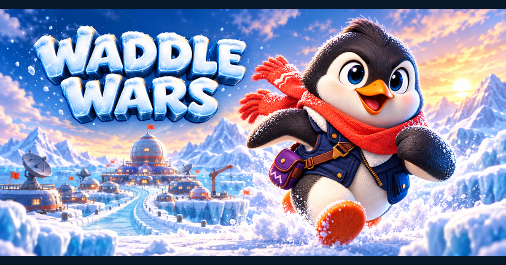

# Waddle Wars

**▶ [Play it now in your browser](https://waddlewars.ninjaconsulting.ai/)** — free, no install, no sign-up, works on phones.

A polished, family-friendly 3D party racing game starring competitive penguins.
Race seven chaotic AI rivals across Antarctic obstacle courses: waddle, belly
slide, hop, swim, shove, and out-item everybody to the finish line.



- **5 handcrafted courses** plus an ever-harder **Endless Expedition**
- **Quick Race, Grand Prix, Time Trial** (with ghost), and a playable tutorial
- **8 real penguin species** to unlock, plus hats and trail cosmetics
- Seven AI rivals with distinct personalities and racing styles
- **Optional online leaderboard** — sign-in is optional; everything works signed out
- Touch controls — plays great on phones and tablets
- Original procedural 3D gameplay art plus authored expedition UI art; original
  generated audio and code. No network runtime dependency; fully functional
  offline.

## Controls

Running is automatic — your penguin always moves forward. You handle steering,
hops, slides, and mischief.

| Action | Keyboard | Gamepad | Touch |
|---|---|---|---|
| Steer | A/D or ←/→ | Left stick | Drag horizontally anywhere |
| Hop | Space | South button (A/✕) | Swipe up |
| Belly slide | Ctrl, S, or ↓ (hold) | East button / LT (hold) | Swipe down and hold |
| Flipper shove | E | West button | SHOVE button |
| Use item | Q | North button / RT | ITEM button |
| Pause | Esc | Start | II button (top-right) |

Keyboard and gamepad bindings are remappable in Settings → Controls.
Slide supports hold or toggle mode, and touch button size/opacity are
adjustable (Settings → Gameplay).

## Game modes

- **Quick Race** — one course, seven AI rivals, three difficulties (Chill / Competitive / Emperor).
- **Grand Prix** — three consecutive races; points decide the cup; best results saved.
- **Endless Expedition** — a seeded, ever-harder course with a blizzard storm on your tail. Score = distance + fish + near misses + rivals outlasted.
- **Time Trial** — no items, race your locally recorded best ghost; best times saved per course.
- **Waddle School** — the interactive tutorial. Finishing it earns fish and an achievement.

## Courses

1. **Glacier Gauntlet** — bright glacier, ice-cave slalom, low slide tunnel, cracking-ice shortcut, rolling snowballs, big final slide.
2. **Aurora Ascent** — twilight climb under the aurora, wind ridges, falling icicles, ridge shortcut, geysers, corkscrew descent.
3. **Iceberg Bay** — sunset ocean, moving/tilting bergs, swim channels, wave ramps, sliding seals.
4. **Cinder Coast** — volcanic black-sand ice shelf, steam vents, lava-lit caves, drifting floes.
5. **Sapphire Hollow** — technical glacier interior with icicle galleries, rolling ice and cold swim channels.

---

# Development

## Requirements

- **Godot Engine 4.7.1** (exactly; the project uses the Mobile renderer, with
  gl_compatibility for the web export)
- Desktop: Windows / macOS / Linux, any GPU with Vulkan or Metal support
- Optional: gamepad; touchscreen supported on mobile-style devices

## Opening and running

```bash
# Open in the editor
godot -e --path /path/to/waddle-wars

# Run the game directly
godot --path /path/to/waddle-wars
```

The main scene is `res://scenes/ui/main.tscn` (boot splash → title).

## Running the automated tests

```bash
./run_tests.sh
# Or individually:
godot --headless res://tests/unit_tests.tscn
godot --headless res://tests/race_sim.tscn -- course=glacier
godot --headless res://tests/race_sim.tscn -- course=aurora
godot --headless res://tests/race_sim.tscn -- course=iceberg
```

`race_sim` runs a full 8-racer AI race at high time scale and fails if any
racer cannot finish. See `TESTING.md` for coverage details.

## Regenerating audio

```bash
python3 tools/generate_audio.py
```

Writes all WAV sound effects and music loops into `assets/audio/` (deterministic,
seed 42). Godot re-imports them on next launch.

## Exporting

Export presets for Web, Windows, macOS, Linux, and Android are configured in
`export_presets.cfg`. Install export templates via **Editor → Manage Export
Templates**, then:

```bash
godot --headless --export-release "Web" build/web/index.html
godot --headless --export-release "Windows Desktop" build/waddle-wars-windows.exe
godot --headless --export-release "macOS" build/waddle-wars-macos.zip
godot --headless --export-release "Linux" build/waddle-wars-linux.x86_64
```

Windowed runner performance probe (JSON and CSV output; add `enforce=true` for
the documented tier gates):

```bash
./run_runner_perf.sh tier=high w=1920 h=1080 warmup=5 seconds=30
```

Deterministic runner golden-slice captures. Wrapper cold-imports a temporary
project identity and emulates touch metrics; defaults produce five ignored
1600×900 review frames under `qa_shots/runner/`. Arguments after defaults
override them:

```bash
./run_runner_capture.sh
./run_runner_capture.sh w=540 h=960 \
  out="$PWD/qa_shots/runner/golden_portrait_review.png"
```

Premium boot/title/loading contract, captures, and frame probe:

```bash
./run_frontend_qa.sh test
./run_frontend_qa.sh shot screen=title out="$PWD/qa_shots/title.png" w=1920 h=1080
./run_frontend_qa.sh perf screen=title seconds=10 enforce=1
```

Authored-art review and parallel-stream merge. Gallery cold-imports an isolated
project and can render either 3D wrapper scenes or 2D texture contact sheets:

```bash
./run_art_gallery.sh group=course_posters \
  out="$PWD/qa_shots/course_posters/catalog.png" w=1920 h=1080
python3 tools/art/merge_art_fragments.py          # read-only conflict check
python3 tools/art/merge_art_fragments.py --apply  # atomic merge + full validation
```

- **Web**: `tools/deploy_cloudflare.sh` exports the build, uploads it to the
  `waddle-wars-web` R2 bucket and redeploys the Worker that serves it at
  https://waddlewars.ninjaconsulting.ai/. The Worker (see `web-host/`) exists
  because the build cannot be hosted on the obvious services: the WASM blob is
  ~38 MB, over Cloudflare Pages' 25 MB per-file ceiling, and GitHub Pages
  cannot send the `Cross-Origin-Opener-Policy` / `Cross-Origin-Embedder-Policy`
  headers at all. `web/share.png` is uploaded alongside the export because the
  `og:image` tag expects it at the site root.
- **Android**: install Android build tools + a debug keystore, set them in Editor
  Settings, then export the `Android` preset. The project already uses the
  Mobile renderer, full-sensor portrait/landscape layouts, safe-area touch
  controls, and `user://` saves.
- **iOS**: requires macOS + Xcode + an Apple developer certificate. Create an
  iOS preset in Project → Export (all project-side requirements — renderer,
  orientation, touch, safe areas — are already satisfied).

## Project structure

```
autoload/            (via project.godot: GameConfig, SaveManager, SettingsManager,
                      AudioManager, Progression, Game, SceneRouter, LeaderboardClient)
assets/audio/        generated WAV sfx + music
assets/art/          runtime art catalog, licenses, manifests, wrapper assets
assets/fonts/        pinned OFL UI font and notice
assets/icons/        icon.svg (original logo/icon)
art_src/             Blender/paint/concept sources (.gdignore, Git LFS)
data/settings/       audio bus layout
leaderboard/         Cloudflare Worker for the optional online leaderboard
scenes/              thin .tscn wrappers; all UI/gameplay built in code
scripts/ai/          AI controller, difficulty + personality tables
scripts/art/         catalog, CharacterLook, runner/course visual profiles
scripts/camera/      chase camera
scripts/characters/  racer state machine, procedural penguin
scripts/courses/     track builder, path guide, course base + 5 courses,
                     endless + tutorial courses
scripts/gameplay/    race manager, powerups, hazards, ghost, endless, tutorial
scripts/input/       player controller, touch controls
scripts/progression/ progression, cosmetics + achievements DBs
scripts/save/        save manager, settings manager
tools/art/           deterministic Blender export + manifest/glTF validators
scripts/ui/          all menu screens, HUD, pause
tests/               headless test scenes + race simulation
tools/               generate_audio.py
web/                 static web assets (share.png social image; .gdignore'd)
```

## Save data

Stored under `user://` (platform-standard location, e.g.
`~/Library/Application Support/Godot/app_userdata/Waddle Wars/` on macOS):
`save.json` (versioned, atomic writes, backup fallback), `settings.json`,
`ghost_<course>.dat` (Time Trial ghosts).

## Adding content

- **Course**: create `scripts/courses/course_yourname.gd` extending `CourseBase`,
  implement `build_course()` (see `course_glacier.gd` as reference), register it
  in `CoursesDB.ITEMS` + `ORDER`.
- **Cosmetic**: add an entry to `CosmeticsDB.ITEMS` and, for new mesh types, a
  branch in `PenguinVisual._apply_cosmetic()`.
- **Power-up**: add to `PowerupsDB.ITEMS`/`ORDER` + weights, implement its
  effect in `PowerupSystem.activate()`.

## Known non-critical limitations

- Export template installation and platform signing (Android keystore, iOS
  certificates) are machine-specific setup and not bundled.
- Music ships as OGG, encoded directly by `tools/generate_audio.py` -- no
  manual conversion step. That does make ffmpeg a hard dependency for the music
  tracks: without it the generator writes WAVs and warns loudly, and the game,
  which looks up `music_*.ogg`, would find no music.
